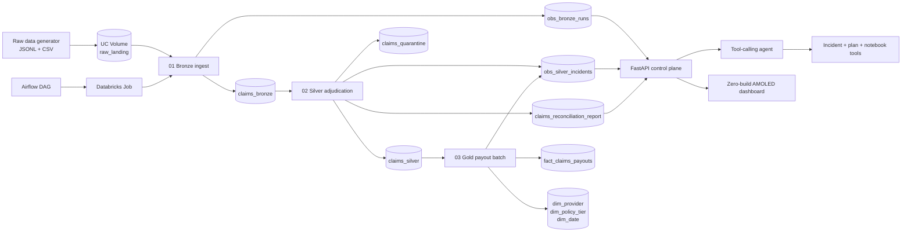
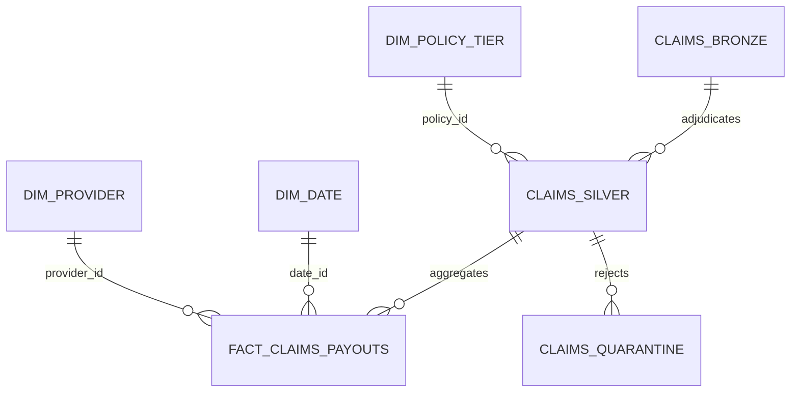

# Claims Reliability Flight Deck

An end-to-end insurance claims lakehouse with automated source-to-target reconciliation, payout-safe incident telemetry, and a tool-calling remediation agent. Built for Databricks Free Edition Serverless Compute and a fully offline local demo.

The pipeline runs Bronze ingestion, Silver adjudication with quarantine routing, and a Gold Star Schema payout batch. The FastAPI control plane runs locally, reads Unity Catalog observability tables or a deterministic SQLite mirror, and serves a pure-black AMOLED dashboard with zero build steps. The agent inspects the incident, reconciliation report, formatted Spark plan, traceback, and the exact notebook source before returning a validated unified diff and retry decision.

## Why this project is different

- **Spark Connect only.** No RDDs, no JVM bridges, no classic cluster configuration. A static audit enforces this.
- **Telemetry without the Spark UI.** Physical plans are captured by redirecting `df.explain(mode="formatted")`, skew is measured with `groupBy`, reconciliation is an explicit DataFrame audit, and stage failures are captured by `observe_stage`.
- **Payout-aware remediation.** A partially committed payout batch is never treated as an ordinary retry. The guardrail forces `MANUAL_CLEANUP_REQUIRED` and an exact `DELETE FROM` statement before any redeploy.
- **Deterministic fallback.** The agent never depends on an external API key. OpenAI-compatible providers, Ollama, and a rule-backed analyzer are all supported.
- **Real verification.** The repository ships with two executable gates that generate 200,000 raw claims, run four scenarios, seed SQLite, exercise every API contract, and scan the codebase for forbidden APIs, comments, and green styling.

## Architecture



The local runtime mirrors the Databricks observability contract in `backend/local_cache.db`. The mock executor generates the same Bronze, Silver, quarantine, reconciliation, incident, and Gold rows that the notebooks write to Delta, which keeps the demo fast and network-free.

## Repository map

```text
.
├── AGENTS.md
├── README.md
├── prd.md
├── .env.example
├── requirements.txt
├── data/
│   └── raw/                        # Generated claims_raw.json, providers.csv, policy_tiers.csv
├── databricks_notebooks/
│   ├── setup_tables.sql
│   ├── observability_helper.py
│   ├── 01_ingest_raw_claims.py
│   ├── 02_adjudicate_claims.py
│   └── 03_generate_payout_batch.py
├── sql/
│   └── business_analytics.sql
├── airflow/
│   └── dags/
│       └── insurance_claims_dag.py
├── backend/
│   ├── config.py
│   ├── db.py
│   ├── databricks_client.py
│   ├── main.py
│   └── agent/
│       ├── schemas.py
│       ├── tools.py
│       ├── prompts.py
│       └── engine.py
├── web/
│   ├── index.html
│   ├── styles.css
│   ├── app.js
│   └── favicon.svg
└── scripts/
    ├── generate_raw_data.py
    ├── test_local_mock.py
    └── test_api_mock.py
```

## One-command local run

Dependencies are installed into `.venv`, the raw scenarios are generated, and the SQLite cache is seeded by the verification gate:

```bash
python3 -m venv .venv
.venv/bin/pip install -r requirements.txt
.venv/bin/python scripts/test_local_mock.py
MOCK_MODE=true .venv/bin/uvicorn backend.main:app --host 0.0.0.0 --port 8000
```

Open `http://localhost:8000`. The dashboard is fully usable without network access. If `backend/local_cache.db` is empty at startup, mock mode seeds all four scenarios automatically.

The single command to relaunch the dashboard after setup is:

```bash
MOCK_MODE=true .venv/bin/uvicorn backend.main:app --host 0.0.0.0 --port 8000
```

## Injectable failure scenarios

The generator writes real landing files under `data/raw/{scenario}/` with 50,000 claims each. The mock executor applies the same validation and payout rules as the notebooks.

| Scenario | Fault | Expected telemetry | Agent decision |
| --- | --- | --- | --- |
| `NORMAL` | Clean 50,000-claim baseline | `SUCCESS`, skew below 5%, rejection below 2%, no incident | No incident raised |
| `A` | 70% of claims land on `HOSP_999`; Silver uses an unsalted join | `DEGRADED`, skew above 65% (about 70.5% observed), SLA breached, delayed HOSP_999 claim total as payout exposure | Salted join diff, `SAFE_TO_RETRY` |
| `B` | `"$1,450.50"` amounts, 4% duplicate IDs, 6% unmapped policies | `FAILED`, 28% rejection rate, 9,000 malformed amounts, 2,000 duplicates, 3,000 unmapped policies, quality gate blocks Silver | Amount-normalization diff with quarantine preserved, `SAFE_TO_RETRY` |
| `C` | Region batch 01 appended, then `RuntimeError("Downstream clearinghouse ledger timeout")` before batch 02 | `FAILED`, `append_non_idempotent`, `CRITICAL`, payout exposure equals committed batch 01 | Delta `MERGE` diff, `MANUAL_CLEANUP_REQUIRED` with exact `DELETE FROM` |

## Data model

### Medallion and observability tables

| Layer | Table | Purpose |
| --- | --- | --- |
| Bronze | `claims_bronze` | Raw string-preserving landing rows with ingest timestamp and `run_id` |
| Silver | `claims_silver` | Deduplicated, typed, validated claims with approved payout |
| Quarantine | `claims_quarantine` | Rejected rows with `DUPLICATE_CLAIM_ID`, `MALFORMED_AMOUNT`, `INVALID_PROVIDER_ID`, `INVALID_POLICY_ID`, or `INVALID_DATE` |
| Audit | `claims_reconciliation_report` | Received, valid, rejected, per-reason counts, rejection rate, total payout |
| Gold | `fact_claims_payouts` | Provider/date/region payout aggregates keyed by `batch_id` and `run_id` |
| Dimension | `dim_provider` | Provider name, network tier, region |
| Dimension | `dim_policy_tier` | Coverage percentage and deductible |
| Dimension | `dim_date` | Date, month, quarter, year |
| Observability | `obs_bronze_runs` | Stage event, formatted plan, traceback, raw metrics |
| Observability | `obs_silver_incidents` | Incident severity, criticality, skew, exposure, write mode, SLA flag |
| Agent | `agent_diagnoses` | Validated diagnosis, unified diff, retry safety, recovery recommendation |

### Gold Star Schema



`fact_claims_payouts` stores one row per provider, claim date, and region batch. The Silver payout formula is:

```text
approved_payout = max(0, claim_amount * coverage_pct - deductible)
```

## Reconciliation workflow

1. **Land raw files.** `claims_raw.json`, `providers.csv`, and `policy_tiers.csv` are uploaded to `/Volumes/workspace/claims_ops/raw_landing/{scenario}/` or generated in place when the Volume is empty.
2. **Preserve Bronze.** Every raw claim is written verbatim as strings with a `run_id`. No validation happens here.
3. **Adjudicate Silver.** Claims are deduplicated by `claim_id`, amounts and dates are validated, provider and policy keys are checked, and approved payout is calculated.
4. **Route quarantine.** Rejected claims retain the full raw payload and a single rejection reason. The precedence is duplicate, malformed amount, invalid provider, invalid policy, invalid date.
5. **Audit reconciliation.** A DataFrame aggregation writes one reconciliation row per run with every rejection category and the total valid payout.
6. **Enforce the quality gate.** Silver publication stops when the rejection rate exceeds 15%. Scenario B intentionally crosses that gate at 28%.
7. **Build Gold.** Only valid Silver rows are grouped into provider/date/region payout batches. Scenario C commits batch 01 and fails before batch 02.
8. **Explain the incident.** The agent reads the incident metrics, reconciliation breakdown, formatted plan, traceback, and notebook source before returning a validated remediation.

## Autonomous remediation agent

The agent exposes three tools:

1. `get_incident_and_reconciliation(incident_id)` returns Silver incident metrics, the matching reconciliation report, and committed Gold fact totals.
2. `get_plan_and_traceback(incident_id)` returns `query_plan_formatted`, `stack_trace`, raw metrics, and the notebook path.
3. `read_notebook_source(notebook_path)` reads the exact PySpark notebook, with path traversal blocked outside `databricks_notebooks/`.

The output contract is enforced by Pydantic:

```json
{
  "root_cause_category": "DATA_SKEW | SCHEMA_DRIFT | PARTIAL_PAYOUT_WRITE | OTHER",
  "summary": "string",
  "insurance_business_impact": "string",
  "payout_exposure_usd": 0.0,
  "code_diff": "unified git diff string",
  "retry_safety": "SAFE_TO_RETRY | MANUAL_CLEANUP_REQUIRED",
  "retry_recommendation": "string"
}
```

Guardrails are non-negotiable:

- Diffs containing `sc.parallelize`, `.rdd`, `._jdf`, or `SparkContext` are rejected.
- Diffs must contain unified `---`, `+++`, and `@@` headers.
- `write_mode == "append_non_idempotent"` forces `MANUAL_CLEANUP_REQUIRED`.
- Manual cleanup recommendations must contain an explicit `DELETE FROM` statement targeting `workspace.claims_ops.fact_claims_payouts` for the exact failed `run_id`.
- The deterministic fallback anchors on real notebook source lines, so the demo still produces a real unified diff with no API key.

## API surface

| Method | Path | Purpose |
| --- | --- | --- |
| `GET` | `/` | Serves `web/index.html` |
| `GET` | `/static/styles.css`, `/static/app.js` | Zero-build static assets |
| `GET` | `/api/health` | Runtime mode, cache freshness, LLM provider, fallback state |
| `GET` | `/api/overview` | Total runs, SLA breaches, payout exposure, latest reconciliation rate |
| `GET` | `/api/incidents` | Prioritized incident queue with diagnosis state |
| `GET` | `/api/incidents?refresh=true` | Refreshes observability rows from the SQL Warehouse before listing |
| `GET` | `/api/incidents/{incident_id}` | Incident metrics, formatted plan, traceback, reconciliation, cached diagnosis |
| `POST` | `/api/scenarios/trigger` | Runs a local mock scenario or calls `WorkspaceClient().jobs.run_now` |
| `POST` | `/api/incidents/{incident_id}/diagnose` | Runs the agent, validates output, persists the diagnosis |
| `GET` | `/api/config` | Public runtime configuration summary |

Example:

```bash
curl -s -X POST http://localhost:8000/api/scenarios/trigger \
  -H 'Content-Type: application/json' \
  -d '{"scenario":"C"}'
```

```bash
curl -s -X POST http://localhost:8000/api/incidents/inc_c_example/diagnose
```

## Dashboard

The dashboard is a single page with no Node, npm, bundler, or compile step.

- **Header and KPI strip:** mode indicator, warehouse sync, total runs, SLA breaches, payout exposure, latest reconciliation rate.
- **Scenario console:** one-click `NORMAL`, `A: Provider Skew`, `B: Schema Drift`, and `C: Partial Payout Commit`.
- **Incident queue:** criticality-first ordering, status dots, error class, exposure, skew, diagnosed badge.
- **Triage workspace:** Run Agent button, retry safety badge, insurance impact card, reconciliation distribution bar, and tabbed artifacts for the PySpark diff, formatted plan, and stack trace.
- **Recovery block:** copyable SQL or command. Manual cleanup is crimson; safe retry is cyan.

The palette is strictly AMOLED and green-free: `#000000` canvas, `#09090B` cards, `#121215` elevated panels, `#27272A` borders, `#FAFAFA` and `#A1A1AA` text, cyan `#06B6D4` for safe states, amber `#F59E0B` for warnings, and crimson `#EF4444` for failures and payout risk. The verification gate parses every hex, rgb, hsl, and named color under `web/` and rejects green hues.

## Verification gates

### Phase 1: pipeline, reconciliation, SQLite, static audits

```bash
.venv/bin/python scripts/test_local_mock.py
```

The gate generates four 50,000-claim scenarios, runs the mock Medallion pipeline, and asserts:

- `NORMAL` status, no incident, skew below 5%, rejection below 2%, and Gold rows.
- `A` status `DEGRADED`, `DATA_SKEW`, SLA breach, skew at least 65%, and payout exposure equal to the independently recomputed delayed HOSP_999 total.
- `B` status `FAILED`, `SCHEMA_DRIFT`, 28% rejection rate, exact 9,000 malformed, 2,000 duplicate, and 3,000 unmapped-policy counts, blocked Silver, and rejected-risk exposure.
- `C` status `FAILED`, `PARTIAL_PAYOUT_WRITE`, `append_non_idempotent`, `CRITICAL`, committed batch 01, uncommitted batch 02, and exposure equal to the SQLite Gold table.
- SQLite contains 200,000 Bronze rows, 150,000 Silver rows, 14,000 quarantine rows, four reconciliation reports, every stage event, three incidents, and the committed fact rows.
- Zero RDD/JVM tokens, zero comments or docstrings, and zero green colors.

Final output:

```text
[PASS] zero RDD/JVM tokens across source files across 24 inspected file(s)
[PASS] zero comments or docstrings across source files across 24 inspected file(s)
[PASS] zero green colors under web/ across 4 inspected file(s)
[PASS] Phase 1 verification gate completed successfully
```

### Phase 2: FastAPI contracts and agent guardrails

```bash
.venv/bin/python scripts/test_api_mock.py
```

The gate uses FastAPI `TestClient` and validates:

- `GET /`, `/static/styles.css`, `/static/app.js`.
- Pydantic-valid `/api/health`, `/api/overview`, and `/api/incidents` responses.
- `POST /api/scenarios/trigger` for Scenarios A, B, and C, including reconciliation counts and exposures.
- `GET /api/incidents/{id}` for each incident, including formatted plans, tracebacks, and reconciliation.
- `POST /api/incidents/{id}/diagnose` for each incident with non-empty unified diffs.
- Scenario C strictly returns `MANUAL_CLEANUP_REQUIRED` and a `DELETE FROM workspace.claims_ops.fact_claims_payouts` statement scoped to the failed `run_id`.
- 404 handling for unknown incidents, 422 handling for unsupported scenarios, and zero green colors in `web/`.

Final output:

```text
[PASS] Scenario C final guardrail is MANUAL_CLEANUP_REQUIRED
[PASS] Scenario C final recovery SQL includes DELETE FROM
[PASS] zero green colors under web/ across 4 inspected file(s)
[PASS] Phase 2 verification gate completed successfully
```

## Databricks Free Edition deployment

Live mode uses Serverless Compute and a Unity Catalog schema under `workspace.claims_ops`.

### 1. Create the schema and tables

Run `databricks_notebooks/setup_tables.sql` in the Databricks SQL editor. It creates the Bronze, Silver, quarantine, reconciliation, dimension, fact, Bronze observability, Silver incident, and agent diagnosis tables as Delta tables.

### 2. Create the raw Volume

```sql
CREATE VOLUME IF NOT EXISTS workspace.claims_ops.raw_landing;
```

Upload the generated scenario directories to `/Volumes/workspace/claims_ops/raw_landing/{NORMAL,A,B,C}/`. Each directory contains `claims_raw.json`, `providers.csv`, and `policy_tiers.csv`. If the Volume is empty, notebook 01 calls the in-repo generator and creates the files in place.

### 3. Import the repository

Import this repository as a Databricks Git folder at `/Workspace/claims_ops`. The notebooks append `repo_root` and `repo_root/databricks_notebooks` to `sys.path` so `observability_helper` and `scripts.generate_raw_data` resolve.

### 4. Create the three-task Serverless Job

Create a Databricks Job with Serverless Compute and three notebook tasks:

| Task | Notebook | Depends on |
| --- | --- | --- |
| `01_ingest_raw_claims` | `databricks_notebooks/01_ingest_raw_claims.py` | none |
| `02_adjudicate_claims` | `databricks_notebooks/02_adjudicate_claims.py` | `01_ingest_raw_claims` |
| `03_generate_payout_batch` | `databricks_notebooks/03_generate_payout_batch.py` | `02_adjudicate_claims` |

Pass these notebook parameters from the Job:

```text
scenario=NORMAL
run_id={{job.run_id}}
catalog=workspace
schema=claims_ops
repo_root=/Workspace/claims_ops
volume_root=/Volumes/workspace/claims_ops/raw_landing
job_id={{job.id}}
```

Change `scenario` to `A`, `B`, or `C` to reproduce a fault. The three stages finish well within Free Edition quotas at 50,000 claims.

### 5. Switch the control plane to live mode

Create `.env`:

```dotenv
MOCK_MODE=false
DATABRICKS_HOST=https://dbc-xxxxxxxx-xxxx.cloud.databricks.com
DATABRICKS_TOKEN=dapi_xxxxxxxxxxxxxxxx
DATABRICKS_HTTP_PATH=/sql/1.0/warehouses/xxxxxxxxxxxxxxxx
DATABRICKS_JOB_ID=1234567890
DATABRICKS_CATALOG=workspace
DATABRICKS_SCHEMA=claims_ops
DATABRICKS_RAW_VOLUME=/Volumes/workspace/claims_ops/raw_landing
CACHE_TTL_SECONDS=60
LOCAL_CACHE_DB=backend/local_cache.db
LLM_PROVIDER=openai
LLM_BASE_URL=https://api.openai.com/v1
LLM_MODEL=gpt-4o-mini
LLM_API_KEY=
LLM_TIMEOUT_SECONDS=45
AGENT_MAX_TOOL_ROUNDS=6
```

Start the control plane:

```bash
.venv/bin/uvicorn backend.main:app --host 0.0.0.0 --port 8000
```

In live mode, `POST /api/scenarios/trigger` calls `WorkspaceClient().jobs.run_now(...)`. `GET /api/incidents?refresh=true` reads `obs_bronze_runs`, `obs_silver_incidents`, and `claims_reconciliation_report` through `databricks-sql-connector` and caches the result in SQLite for `CACHE_TTL_SECONDS`.

### 6. Airflow orchestration

`airflow/dags/insurance_claims_dag.py` schedules the Databricks Job at `06:00` daily with a `DatabricksRunNowOperator`. It includes a `run_claims_pipeline` task with an 8-minute SLA, an `ALL_DONE` notification task, failure and SLA-miss callbacks, and optional webhook delivery through `ALERT_WEBHOOK_URL`.

Required Airflow environment:

```dotenv
DATABRICKS_CONN_ID=databricks_default
DATABRICKS_JOB_ID=1234567890
CLAIMS_SCENARIO=NORMAL
CLAIMS_REPO_ROOT=/Workspace/claims_ops
ALERT_WEBHOOK_URL=
```

## LLM configuration

The agent speaks the OpenAI chat-completions tool-calling protocol, so it works with any compatible endpoint.

| Provider | Configuration |
| --- | --- |
| OpenAI or compatible | `LLM_PROVIDER=openai`, `LLM_BASE_URL=https://api.openai.com/v1`, `LLM_MODEL=gpt-4o-mini`, `LLM_API_KEY=...` |
| Ollama | `LLM_PROVIDER=ollama`, `LLM_BASE_URL=http://localhost:11434/v1`, `LLM_MODEL=qwen2.5-coder:14b`, `LLM_API_KEY=` |
| No key or unreachable endpoint | The deterministic rule-backed analyzer runs automatically |

The fallback is not a mock string. It reads the incident, reconciliation report, formatted plan, traceback, and exact notebook source, then builds a real anchored unified diff.

## Sample agent output

Representative offline diagnosis for Scenario C:

```json
{
  "root_cause_category": "PARTIAL_PAYOUT_WRITE",
  "summary": "03_generate_payout_batch appended region batch 01 for run run_c_973726dcbd45, committing $24,645,216.42 across 11666 fact rows, then failed before region batch 02. The ledger now holds a partial payout batch while the orchestrator records the run as failed.",
  "insurance_business_impact": "A blind append retry would duplicate the already committed region payouts and create a double-payment risk in the clearinghouse. Finance cannot close the payout cycle until the partial batch is reconciled and removed, and providers in the held regions face delayed settlement.",
  "payout_exposure_usd": 24645216.42,
  "code_diff": "--- a/databricks_notebooks/03_generate_payout_batch.py\n+++ b/databricks_notebooks/03_generate_payout_batch.py\n@@ -106,9 +106,29 @@\n...",
  "retry_safety": "MANUAL_CLEANUP_REQUIRED",
  "retry_recommendation": "MANUAL CLEANUP REQUIRED. Do not retry the append writer. Remove the partial payout batch first:\n\nDELETE FROM workspace.claims_ops.fact_claims_payouts WHERE run_id = 'run_c_973726dcbd45';\n\nConfirm that the run has zero committed fact rows before deploying the MERGE diff and rerunning 03_generate_payout_batch with a new run_id.",
  "model_used": "deterministic-rule-engine"
}
```

The generated diff replaces the non-idempotent append with a Delta `MERGE` keyed by `run_id`, `provider_id`, and `date_id`:

```diff
--- a/databricks_notebooks/03_generate_payout_batch.py
+++ b/databricks_notebooks/03_generate_payout_batch.py
@@ -106,9 +106,29 @@
     try:
         with stage:
             dim_date.write.mode("overwrite").option("overwriteSchema", "true").saveAsTable(f"{catalog}.{schema}.dim_date")
-            batch_one.write.mode("append").saveAsTable(fact_table)
-            stage.set_metrics(row_count_in=fact_count, row_count_out=batch_one_count)
-            raise RuntimeError("Downstream clearinghouse ledger timeout")
+            from delta.tables import DeltaTable
+            target = DeltaTable.forName(spark, fact_table)
+            (
+                target.alias("target")
+                .merge(
+                    batch_one.alias("source"),
+                    "target.run_id = source.run_id AND target.provider_id = source.provider_id AND target.date_id = source.date_id",
+                )
+                .whenMatchedUpdateAll()
+                .whenNotMatchedInsertAll()
+                .execute()
+            )
+            (
+                target.alias("target")
+                .merge(
+                    batch_two.alias("source"),
+                    "target.run_id = source.run_id AND target.provider_id = source.provider_id AND target.date_id = source.date_id",
+                )
+                .whenMatchedUpdateAll()
+                .whenNotMatchedInsertAll()
+                .execute()
+            )
+            stage.set_metrics(row_count_in=fact_count, row_count_out=batch_one_count + batch_two_count)
     except Exception:
         committed_row = (
             spark.table(fact_table)
```

## Business SQL pack

`sql/business_analytics.sql` contains five Databricks SQL queries against the Gold Star Schema and reconciliation contract:

1. Top 10 healthcare providers by approved payout volume.
2. Regional payout distribution and average claim value.
3. Monthly claims volume and payout trend with month-over-month change.
4. Policy-tier coverage utilization and deductible impact.
5. Source-to-target reconciliation and rejection breakdown audit.

## Engineering constraints

- **No RDD or JVM APIs.** The static audit rejects `sc.parallelize`, `.rdd`, `._jdf`, and `SparkContext`.
- **No comments or docstrings** in `.py`, `.sql`, `.html`, `.css`, or `.js`.
- **No green styling.** Safe states use cyan or white. Warnings use amber. Failures and payout risk use crimson.
- **No frontend build.** FastAPI serves the static files directly.
- **No network dependency in mock mode.** Raw generation, pipeline execution, SQLite caching, agent diagnosis, and the dashboard all work offline.
- **No silent retry after a partial payout commit.** The cleanup SQL must run before an idempotent writer is redeployed.

## Live workspace evidence

This repository is fully built and verified in local mock mode. The live Databricks Free Edition path is implemented but was not executed here because no workspace host, token, SQL Warehouse, or Job ID were provided. A live run is not claimed.

After following the deployment steps, capture these evidence slots for the submission:

| Evidence | Suggested file |
| --- | --- |
| Three-task Serverless Job DAG | `docs/screenshots/databricks-job-dag.png` |
| Unity Catalog Bronze/Silver/Gold tables | `docs/screenshots/unity-catalog-tables.png` |
| Reconciliation report query output | `docs/screenshots/reconciliation-output.png` |
| Dashboard with a diagnosed Scenario C incident | `docs/screenshots/dashboard-scenario-c.png` |

The agent and dashboard behave identically in live mode once the SQL Warehouse sync has populated the local cache.

## Troubleshooting

- **`ModuleNotFoundError: fastapi`** — run `.venv/bin/python`, not the system interpreter.
- **Empty incident queue** — run `scripts/test_local_mock.py` or start the app with an empty SQLite cache so it seeds automatically.
- **Live sync returns 502** — verify `DATABRICKS_HTTP_PATH` points to a SQL Warehouse and the token has `CAN_USE` and `SELECT` permissions.
- **Agent always uses the fallback** — check `LLM_API_KEY`, `LLM_BASE_URL`, and `LLM_MODEL`. A failed provider call falls back by design.
- **Scenario C says `SAFE_TO_RETRY`** — that should be impossible. The Pydantic guardrail rejects the payload; check that `write_mode` is `append_non_idempotent` in the incident row.
